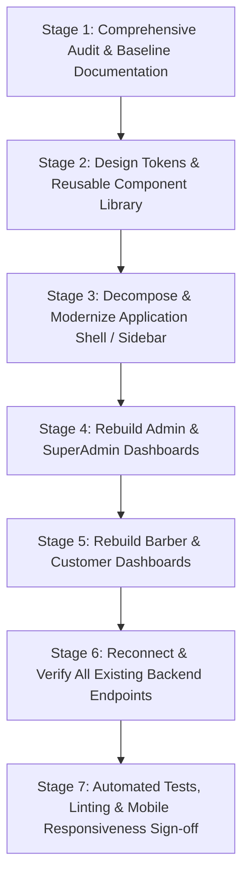

# CANDYCUTZ — Comprehensive Application & Dashboard Audit Report

**Date:** November 14, 2026  
**Auditor:** Senior Laravel Software Architect, UI/UX Designer & Full-Stack Systems Engineer  
**Status:** Ground Truth Audit Complete (Phase 1 Baseline)  
**Authoritative Reference:** [`ARCHITECTURE.md`](../ARCHITECTURE.md)

---

## 1. Existing System Architecture

CandyCutz is a luxury grooming, barbershop management, and appointment scheduling platform. The production topology operates as a cohesive web, mobile, and API ecosystem:

```
┌────────────────────────────────┐        ┌───────────────────────────────┐
│       barbing-saloon-web       │        │       MOBILE/ Standalone      │
│  Vue 3.5 SPA / PWA (Vite 8)    │        │  Expo SDK 52 / React Native   │
│  Tailwind CSS 4.3 + Pinia      │        │  Dedicated Client & Shared DTO│
└───────────────┬────────────────┘        └───────────────┬───────────────┘
                │                                         │
                │      HTTP / JSON API (/api/v1/*)        │
                ▼                                         ▼
┌─────────────────────────────────────────────────────────────────────────┐
│                           barbing-saloon-api                            │
│                     Laravel 12.68.0 (PHP 8.5-FPM)                       │
│    Sanctum Auth (Stateful SPA Cookies + Bearer Tokens)                  │
│    Domain Layer Architecture (Identity, Booking, Content, System)       │
└───────────────────────────────────┬─────────────────────────────────────┘
                                    │
               ┌────────────────────┴────────────────────┐
               ▼                                         ▼
┌──────────────────────────────┐          ┌──────────────────────────────┐
│           MySQL 8.0          │          │           Redis 7.2          │
│    Primary Data Store        │          │   Cache, Sessions, Queues    │
│    (candycutz_db / 3306)     │          │   (candycutz-redis:6379)     │
└──────────────────────────────┘          └──────────────────────────────┘
```

### 1.1 Technology Stack Inventory
* **Backend:** Laravel `12.68.0` on PHP `8.5.0`, utilizing strict typing (`declare(strict_types=1)`), Domain-driven actions in `app/Domain/`, and standard form request validation.
* **Frontend Web:** Vue `3.5.0`, Vite `8.0.16`, Vue Router `4.4.0`, Pinia `2.1.0`, Tailwind CSS `4.3.3`, PostCSS `8.4.0`, Lucide Icons (`lucide-vue-next` `1.0.0`), Heroicons (`@heroicons/vue` `2.2.0`), Dayjs `1.11.0`, Vee-Validate `4.13.0` + Yup `1.4.0`, and HTML2PDF.
* **Database & In-Memory Storage:** MySQL 8.0 InnoDB (transactional engine), Redis 7.2 Alpine (cache, session driver, queue worker).
* **Ingress & Web Server:** Nginx reverse proxy serving compiled static assets from `/var/www/web/dist` and proxying `/api/v1/*` requests to PHP-FPM FastCGI on port 9000.
* **Mobile Infrastructure:** Standalone Expo / React Native codebase in `MOBILE/` interacting exclusively with `/api/v1/*`.

---

## 2. Existing Dashboard Structure by Role

The web frontend implements four distinct portal layouts and dashboard views:

| Role | Route Mount | Primary Layout | Core Dashboard View Component |
| :--- | :--- | :--- | :--- |
| **Super Admin** | `/superadmin/dashboard` | `SuperAdminLayout.vue` | `src/modules/superadmin/pages/DashboardPage.vue` |
| **Admin** | `/admin/dashboard` | `AdminLayout.vue` | `src/modules/admin/pages/DashboardPage.vue` |
| **Barber** | `/barber/dashboard` | `BarberLayout.vue` | `src/features/barber/pages/BarberDashboardPage.vue` |
| **Customer** | `/customer/dashboard` | `CustomerLayout.vue` | `src/modules/customer/pages/DashboardPage.vue` |

### 2.1 Existing Layout & Shell Implementation
* **Shared Shell:** Both `AdminLayout.vue` and `SuperAdminLayout.vue` delegate to `core/layouts/DashboardLayout.vue`, which mounts `DashboardSidebar.vue` and `DashboardHeader.vue`.
* **Sidebar Overcrowding:** `AdminLayout.vue` passes an un-grouped, flat array of 35+ links (`navItems`), resulting in an overwhelming vertical sidebar list that forces continuous scrolling on standard laptop displays.
* **Component Size Violation:** `DashboardSidebar.vue` spans **574 lines of code** (violating the repository's 300-line architecture limit), with tangled ternary theme operators (`props.theme === 'superadmin' ? ... : ...`).
* **Visual Theme Inconsistency:** SuperAdmin is styled in high-contrast red/black (`text-red-500`, `border-red-600`), Admin in orange/graphite (`text-[#FF6700]`, `bg-[#010405]`), and Customer/Barber in luxury gold (`#FF9900` / `#CC7A00`). Rather than a cohesive SaaS suite with tasteful role accent badges, the portals look like three disconnected applications.

---

## 3. Website Content Inventory (Preservation Matrix)

All existing public website content and CMS capabilities must be preserved with zero data or functional loss:

### 3.1 Public Website Pages (`src/modules/public/pages/`)
1. **Home Page (`HomePage.vue`):** Hero headline (*"Premium grooming with a sharper standard"*), interactive 3D hero card, service category teasers, featured barbers spotlight, customer testimonials, VIP pricing showcase, booking CTA ribbon.
2. **About Us (`AboutPage.vue`):** Brand narrative, craftsmanship heritage, master barber team profiles, shop hygiene and sterilization protocols.
3. **Services (`ServicesPage.vue`):** Category tab filtering (Haircuts, Beard Grooming, Hair Treatment, Styling), service pricing in Naira/Kobo, duration in minutes, instant booking drawer links.
4. **Gallery (`GalleryPage.vue`):** Tagged high-resolution lookbook (Haircuts, Beards, Shop Interior), lightroom modal view, barber attribution.
5. **Contact (`ContactPage.vue`):** Shop hours, map location, live inquiry form, customer direct support telephone, email dispatch.
6. **Legal & Compliance:**
   - `TermsPage.vue` — Client service terms, cancellation policies, late arrival forfeiture rules.
   - `PrivacyPage.vue` — Data protection, cookie consent, GDPR/NDPR compliance disclosures.
   - `SecurityPage.vue` — Payment security, PCI-DSS compliance statement via Paystack/Stripe.
   - `CookiePreferencesPage.vue` — Granular analytics and functional cookie controls.
   - `AccountDeletionPage.vue` — Self-service data privacy erasure protocol.

### 3.2 Content Management System (`src/features/cms/`)
* **Hero Settings:** Live preview editor (`CmsHomeLivePreview.vue`), headline modifier, background image opacity slider (`hero_opacity`, `hero_image_opacity`), color tint overlay presets (`OverlayPresetsManager.vue`).
* **Section CMS Controls:** About Us teaser editor, Stats grid modifier (Clients served, Master barbers, Years of craft), Portal callout banners, and navigation quick-links.

---

## 4. Existing User Roles & Authorization Hierarchy

| Role | Database Value | Scope & Capabilities |
| :--- | :--- | :--- |
| `super_admin` | `'super_admin'` | Full system ownership: manage admins, user lifecycle, system backups, PHP health checks, server telemetry, error logs, audit logs, global financial overrides. |
| `admin` | `'admin'` | Shop operations: walk-in booking dispatch, appointment calendar management, customer CRM, barber assignments, manual bank transfer verification, gallery/blog publication, feedback inbox. |
| `barber` | `'barber'` | Assigned chair operations: personal agenda, mark appointment completion/no-show, venue payment collection, personal portfolio gallery, working hours/blocked slots. |
| `customer` | `'customer'` | Self-service grooming: book appointments, view active verification codes, upload manual bank transfer receipts, submit reviews, manage wishlist, profile notification preferences. |

---

## 5. Route Inventory & API Mapping

The backend API exposes **318 registered routes**, strictly partitioned under `/api/v1/*`:

### 5.1 Route Group Summary
* **Authentication (`routes/api/v1/auth.php`):** `/api/v1/auth/login`, `/api/v1/auth/register`, `/api/v1/auth/social-login`, `/api/v1/auth/email/verify/*`, `/api/v1/auth/logout`, `/api/v1/auth/me`.
* **Catalogue & Public (`routes/api/v1/catalogue.php`):** `/api/v1/services`, `/api/v1/barbers`, `/api/v1/gallery`, `/api/v1/testimonials`, `/api/v1/blog`, `/api/v1/settings`, `/api/v1/working-hours`, `/api/v1/available-slots`.
* **Bookings (`routes/api/v1/booking.php`):** `/api/v1/appointments`, `/api/v1/appointments/walk-in`, `/api/v1/appointments/{id}/status`, `/api/v1/availability`.
* **Payments (`routes/api/v1/payments.php`):** `/api/v1/payments/checkout-data`, `/api/v1/payments/confirm-transfer`, `/api/v1/payments/webhook`, `/api/v1/payments/appointments/{id}/receipt`.
* **Account & Customer Portal (`routes/api/v1/account.php`):** `/api/v1/customer/dashboard`, `/api/v1/customer/bookings`, `/api/v1/customer/my-codes`, `/api/v1/customer/wishlist`, `/api/v1/customer/reviews`.
* **Barber Portal (`routes/api/v1/account.php`):** `/api/v1/barber/dashboard`, `/api/v1/barber/appointments`, `/api/v1/barber/schedule`, `/api/v1/barber/my-status`, `/api/v1/barber/gallery`.
* **Admin Portal (`routes/api/v1/admin.php`):** `/api/v1/admin/dashboard`, `/api/v1/admin/appointments`, `/api/v1/admin/customers`, `/api/v1/admin/barbers`, `/api/v1/admin/payments`, `/api/v1/admin/reports`, `/api/v1/admin/system/*`.
* **Super Admin Portal (`routes/api/v1/admin.php`):** `/api/v1/superadmin/dashboard`, `/api/v1/superadmin/users`, `/api/v1/superadmin/audit-logs`, `/api/v1/superadmin/settings`.

---

## 6. Database Assessment & Data Integrity

The database comprises **42 migration files** and **38 Eloquent models**.

### 6.1 Core Relational Schema
* `users` — Primary credentials, multi-role field (`enum('super_admin','admin','barber','customer')`), `is_active`, soft-deletes (`deleted_at`).
* `barbers` — Foreign key `user_id` referencing `users.id`, experience years, rating, availability status, bank transfer details.
* `services` & `service_categories` — Grooming catalog with prices stored in integers/kobo, duration in minutes, availability flags.
* `appointments` — State machine (`pending`, `confirmed`, `completed`, `cancelled`, `no_show`), slot lock key, customer verification codes, barber assignment.
* `payments` & `payment_transactions` — Financial auditing, Paystack/Stripe references, receipt image paths, manual transfer verification timestamps.
* `settings` — Key-value dictionary for dynamic operational configuration and CMS themes.

### 6.2 Data Integrity Rules
* **No Destructive Migrations:** Existing production tables, columns, and foreign key constraints must not be dropped.
* **Preserve Idempotent Seeders:** `LegacyDataSeeder.php` uses `INSERT IGNORE INTO` to prevent duplicate key crashes.
* **Database Isolation:** Testing is strictly isolated to SQLite in-memory with the `CRITICAL SAFETY SHIELD` in `TestCase.php`.

---

## 7. API and Integration Assessment

1. **Paystack Integration (`PaystackGateway.php`):**
   Handles standard Nigerian card checkouts and webhook signature validation (`x-paystack-signature`). Operates in kobo integers.
2. **Stripe Integration (`StripeGateway.php`):**
   Handles international card payments via Stripe PaymentIntents and Webhook signatures (`stripe-signature`).
3. **Manual Bank Transfer Gateway (`ManualTransferGateway.php`):**
   Allows customers to transfer directly to shop or barber bank accounts, upload receipt snapshots, and await admin/barber verification.
4. **Transactional Email (`BrevoApiClient.php`):**
   Dispatches transactional appointment confirmations, verification codes, and password reset OTPs via Brevo API v3.
5. **Push Notifications & Mobile Telemetry:**
   Stores device tokens in `device_tokens`, tracks crashes in `app_crashes`, and records app versions in `app_versions`.

---

## 8. Issue Classification (P0 - P3)

### Priority P0: Critical Security, Data Integrity or Payment Risks
* **None identified in current state.** Previous database wipe risk on `php artisan test` has been mitigated via SQLite test isolation and the `TestCase.php` runtime guard.

### Priority P1: Major Broken Functionality & Structural Violations
* **File Size Rule Violations (Architecture Rule):**
  - `barbing-saloon-web/src/core/layouts/components/DashboardSidebar.vue` is **574 lines** (exceeds the 300-line limit).
  - `barbing-saloon-web/src/modules/superadmin/pages/DashboardPage.vue` is **468 lines** (exceeds 300-line limit).
  - `barbing-saloon-web/src/modules/customer/pages/DashboardPage.vue` is **336 lines** (exceeds 300-line limit).
* **Flat Navigation Clutter:** Over 35 un-grouped items in `AdminLayout.vue` navigation list, mixing low-frequency CMS links with daily appointment/customer triage.

### Priority P2: UI, Responsiveness, Information Hierarchy & UX Problems
* **Clashing Portal Color Palettes:** Extreme color shifts between SuperAdmin (harsh pure red `#EF4444` on jet black), Admin (orange `#FF6700`), and Customer (amber `#FF9900`), destroying visual continuity.
* **Lack of Progressive Disclosure in Sidebar:** Sidebar does not support accordion collapsible groups (e.g. collapsing "Website CMS" or "System Governance" into clean sub-drawers).
* **Information Density on Dashboard Overviews:** Admin dashboard uses large SVG charts that push critical operational workflows (pending walk-ins, unverified bank receipts) far below the fold.
* **Mobile Table Overflow:** Standard desktop tables on smaller screens suffer from horizontal clipping or unstyled scrollbars without adaptive mobile cards.

### Priority P3: Minor Improvements & Visual Polish
* **Inconsistent Badge Tokens:** Status badges across Appointments, Reviews, and Barbers use varying raw Tailwind classes instead of unified semantic token components (`StatusBadge.vue`).
* **KPI Card Alignment:** Metric numbers and trend indicators lack uniform padding, icons, and sparkline styling across all 4 portal dashboards.

---

## 9. Recommended Redesign Architecture

### 9.1 Unified Design System Tokens (`DESIGN-SYSTEM.md`)
Preserve CandyCutz's authentic luxury barbershop heritage with a unified **Champagne Gold & Obsidian Slate** design language across all portals, using discrete, elegant accent badges to denote administrative authority:
* **Base Surface:** Obsidian Slate (`#0B0F17` dark, `#FAF9F6` light).
* **Primary Brand Accent:** Champagne Gold (`#D4AF37` / `#FF9900` hover).
* **Secondary Surface:** Rich Charcoal (`#131B26` dark, `#FFFFFF` light).
* **Borders:** Subtle Glass Frost (`rgba(255, 255, 255, 0.08)` dark, `rgba(0, 0, 0, 0.08)` light).
* **Role Accents (Discreet Badges & Active Glows Only):**
  - Super Admin: Crimson Ruby (`#EF4444`)
  - Admin: Tangerine Amber (`#F97316`)
  - Barber: Emerald Mint (`#10B981`)
  - Customer: Royal Gold (`#F59E0B`)

### 9.2 Modular Layout Architecture
Decompose the monolithic `DashboardSidebar.vue` and `DashboardLayout.vue` into reusable, sub-300 line components:
1. `SidebarShell.vue` — Collapsible desktop & mobile off-canvas drawer.
2. `SidebarBrand.vue` — Authentic CandyCutz emblem + portal role indicator.
3. `SidebarNavGroup.vue` — Accordion-capable navigation group with progressive disclosure.
4. `SidebarNavItem.vue` — Accessible link with active glow, count badge, and keyboard focus.
5. `SidebarUserProfile.vue` — User avatar, role title, theme toggle, and quick logout.
6. `TopNavigation.vue` — Global breadcrumbs, quick search, notifications flyout, and contextual action buttons.

### 9.3 Actionable Executive Dashboard Overview
Rethink each portal's home overview to prioritize information that demands user action:
* **Admin / SuperAdmin:** Instant action strip for pending manual bank transfers requiring receipt review, today's live walk-in chair queue, revenue metrics (kobo to formatted Naira), and booking trends.
* **Barber:** Real-time today's timeline, active chair toggle, next customer arrival countdown, verified earnings summary.
* **Customer:** Upcoming grooming countdown, instant 4-digit verification code display, 1-click rebook, and payment status.

---

## 10. Phased Implementation Sequence



1. **Phase 1 (Complete):** Ground truth audit, technology inspection, content inventory, and issue classification.
2. **Phase 2:** Design token consolidation and building atomic UI components (`StatCard.vue`, `StatusBadge.vue`, `DataTable.vue`, `ActionDropdown.vue`).
3. **Phase 3:** Refactoring `DashboardLayout.vue`, `DashboardSidebar.vue`, and `DashboardHeader.vue` into lightweight, modular, accordion-enabled components under 300 lines.
4. **Phase 4:** Rebuilding Admin & Super Admin dashboard home pages with actionable triage cards, compact charts, and clean responsive grids.
5. **Phase 5:** Modernizing Barber and Customer dashboards.
6. **Phase 6:** Full end-to-end verification across all 318 API routes, roles, and automated test suites.

